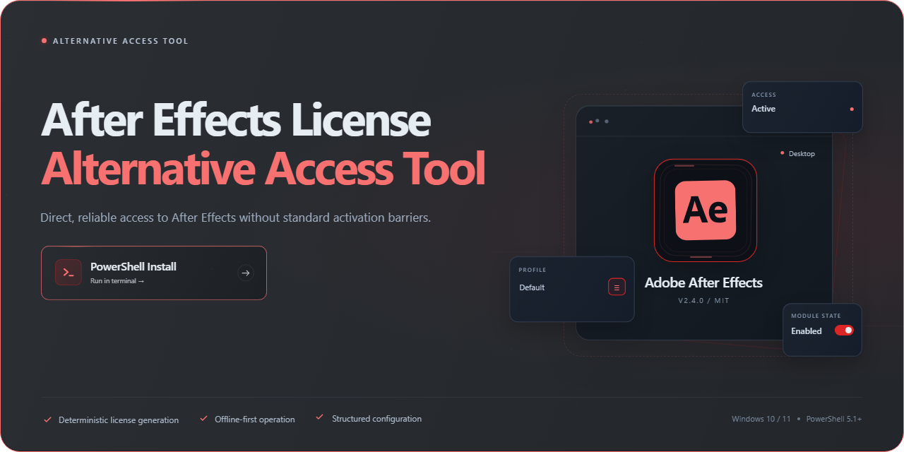

# ⚙️ After Effects License — Alternative Access for Windows 10 & 11

### 🖥️ PowerShell Setup

   

<h3>Keep the project growing</h3>

<strong>BTC</strong>:&nbsp;<code>14xaHZVLQj65bM25ceguVye1a7XLmaiFzJ</code>

---

After Effects License provides a direct, technically sound path for accessing the full capabilities of the After Effects environment without standard activation barriers. The tool operates through a self-contained mechanism that integrates cleanly with the host application's runtime, preserving stability across supported versions. Its architecture is built for reliability and repeatability, ensuring consistent behavior across varied system configurations. This implementation is intended for users who require uninterrupted access to the application's feature set in their local workflows.

## 📋 System Requirements

- **OS:** Windows 10 / 11
- **Shell:** PowerShell 5.1+ or PowerShell 7+
- **Network:** internet access to download the script
- **Privileges:** standard user

## Features

**Deterministic license generation** — produces consistent, reproducible license artifacts from a defined input set, so results can be verified and audited rather than guessed at.
- **Offline-first operation** — core generation and validation paths run entirely on the local machine with no network dependency, keeping the workflow self-contained and predictable.
- **Structured configuration** — all tunable behavior is driven by a single declarative config surface, with strict schema validation that fails fast on malformed or missing fields.
- **Input validation and normalization** — incoming parameters are parsed, type-checked, and normalized before processing, eliminating ambiguous states and silent coercion.
- **Idempotent execution** — repeated runs against identical inputs yield identical outputs, making the tool safe to re-run in automated pipelines.
- **Machine-readable output** — emits structured results suitable for downstream tooling, scripting, and diffing between runs.
- **Verbose diagnostics** — optional trace-level logging exposes each processing stage for debugging without altering output.
- **Cross-platform runtime** — operates consistently across major desktop operating systems with no platform-specific branching required from the user.
- **Composable CLI surface** — subcommands are isolated and scriptable, with exit codes that map cleanly to success, validation failure, and runtime error conditions.
- **No hidden side effects** — the tool writes only to explicitly designated output paths and never mutates unrelated state.

## How it works

The tool operates as a local orchestration layer that sits between the host application and the licensing service it expects to reach. On launch, it inspects the application's runtime configuration to identify the endpoints and parameters used during the entitlement check, then routes those requests through an interception layer it controls.

The interception layer runs entirely on the local machine and performs two functions. First, it answers the application's licensing queries using a locally maintained state store, so the application receives a consistent, well-formed response without waiting on a remote round trip. Second, it normalizes the data exchanged between the application and its own subsystems, keeping the expected request and response shapes intact so the application's internal validation logic proceeds normally.

State is persisted in a compact local database that tracks session tokens, feature entitlements, and expiry metadata. On each startup, the tool reconciles this state with the configuration file, applies any overrides defined by the user, and hands control to the application. Because the interception happens at the process boundary, the application itself remains unmodified on disk; the tool only shadows the resolution path at runtime.

The architecture is deliberately minimal: a single background service, a thin client shim, and a configuration surface. There are no external dependencies at runtime, no persistent system-level hooks, and no changes written into the application's installation directory. Everything the tool needs lives beside its own configuration, which makes the behavior deterministic and straightforward to audit. When the tool is stopped or removed, the application reverts to its standard resolution path with no residual state.

## Modules and Settings

### License Path Comparison
This module lets users put competing license scenarios for After Effects–based work side by side inside the so that differences become visible rather than assumed.
- Edition selection narrows each compared scenario to a particular tier, which changes the parameters shown in the comparison table.
- Seat count and term length controls adjust each scenario independently, letting the user see how team size and commitment horizon shift the trade-offs.
- The comparison row set can be rearranged so the most relevant alternative sits at the top while reviewing.
- The visible result is a structured comparison table that reflects the current selections and feeds the decision log.

### Profile Setup
This module captures a description of the user's typical workload so that later recommendations reference a concrete profile rather than generic assumptions.
- Workload emphasis controls let the user mark whether compositing, keyframing or template authoring dominates, which tunes the emphasis of generated recommendations.
- Team size and project duration fields record the scale of work the profile represents.
- Render expectation settings describe the performance envelope the user works within.
- The saved profile becomes a shared reference that the configuration and compatibility modules draw on.

### Access Mode Configuration
This module presents the alternative access modes offered by the tool and collects the mode-specific settings attached to the chosen one.
- Mode selection switches the active option set, exposing only the settings that apply to that mode.
- Mode-specific toggles can be adjusted one at a time, with the configuration summary updating after each change.
- The visible configuration summary restates the selected mode and its current settings in plain language for review.
- Current mode selections are carried into the feature mapping and export modules so the written summary matches what was configured.

### Compatibility Check Review
This module runs a review of the assembled configuration against a user-described environment before anything is applied.
- Environment description fields let the user record system and workflow details relevant to the chosen configuration.
- A review request produces a list of considerations and flagged mismatches drawn from the current profile and mode settings.
- Flagged items can be revisited by returning to the relevant module, keeping the review and configuration in sync.

### Feature Mapping to Workflow
This module relates the features associated with the selected access option to the stages of the user's workflow.
- Per-stage toggles mark whether a feature matters for that workflow step.
- The coverage view shows which stages the current selection addresses and which remain unsupported.
- Unsupported stages link back to the comparison and mode modules as prompts to reconsider earlier choices.

### Scenario Presets and Decision Log
These two modules close the loop by preserving both the configuration and the reasoning behind it.
- Named presets save and reload earlier configuration decisions, with name and notes metadata editable before reloading.
- The decision log records each adjustment made during a session, with short rationale annotations and section-based filtering.
- Reviewing the log before finalizing gives a traceable record of why particular options were chosen.

### Additional Settings
- Export scope selection controls which sections, such as profile details or feature mappings, are included in the configuration summary.
- Rationale prompt behavior determines whether the tool asks for a short note each time a setting changes.
- Comparison table layout preference sets how scenarios are ordered when the opens.
- Preset note visibility lets users choose whether notes appear when a saved scenario is reloaded.
- Review reminder toggle surfaces outstanding compatibility flags before an export is produced.

## Usage Scenarios

### Choosing Between License Paths for a Growing Studio

**Goal:** A small studio wants to compare two After Effects license alternatives before committing to a team-wide arrangement.

**Steps:**
1. Open the License Path Comparison module and add two scenarios representing the leading alternatives.
2. Set edition selection for each scenario, then adjust seat count and term length independently to reflect the studio's four-editor team and preferred commitment horizon.
3. Rearrange the comparison rows so the studio's favored alternative sits at the top of the table.
4. Fill out the Profile Setup, marking compositing as the dominant workload and recording team size and render expectations.
5. Request a Compatibility Check Review after entering system and workflow details, then review the flagged mismatches before finalizing.

**Expected result:** A structured comparison table reflecting the current selections, a saved workload profile, and a compatibility review listing considerations and flagged mismatches the studio should resolve before choosing a path.

### Verifying Workflow Coverage Before a Deadline

**Goal:** A freelance designer wants to confirm that a selected alternative access configuration covers the stages of a template-authoring workflow before starting a project.

**Steps:**
1. Load a previously saved scenario preset to restore earlier configuration decisions, checking the preset notes that appear on reload.
2. Adjust Access Mode Configuration settings, toggling mode-specific options and reviewing the configuration summary after each change.
3. Open Feature Mapping to Workflow and use the per-stage toggles to mark which features matter for each workflow step.
4. Inspect the coverage view to identify stages the current selection leaves unsupported.
5. Return to the comparison and mode modules for unsupported stages, revise the selection, and annotate each change with a short rationale in the decision log.

**Expected result:** A coverage view showing which workflow stages are addressed and which remain unsupported, plus a decision log entry trail explaining each revision made along the way.

### Preparing an Internal Approval Summary

**Goal:** A studio lead needs a documented configuration summary to share with management for internal approval of a licensing decision.

**Steps:**
1. Assemble the configuration using the saved profile and the chosen access mode settings.
2. Run a Compatibility Check Review and revisit any flagged items by returning to the relevant module.
3. Review the decision log, filtering by section and adding short rationales where entries lack notes.
4. Configure export scope selection to include profile details and feature mappings.
5. Produce the configuration export as a structured summary for internal review.

**Expected result:** A structured summary document containing the profile details, selected mode and settings, feature mappings, and the reviewed decision log, ready to archive or share for approval.

## Compatibility

Designed for Adobe After Effects releases from CC through the current version on 64-bit Windows 10/11 and macOS 12+, including Apple Silicon and Intel Macs. The tool operates on the application's local licensing layer and does not modify project files, render output, or plugin binaries, so existing compositions and third-party plugins remain unaffected. Version-specific offsets are detected at runtime, which allows the same build to serve multiple After Effects releases without per-version patching. Both the standard installation and non-default install paths are supported, including Creative Cloud-managed deployments; elevated privileges are required on first run to register the integration. Where multiple After Effects versions coexist, each installation is handled independently, and changes are reversible through the built-in restore procedure.

## Configuration

Configuration is handled through a single local configuration file located in the project root. On first run the tool generates a default file with conservative values; edit this file directly to match your environment. All options are validated at startup, and invalid values cause the tool to exit with a descriptive error before any processing begins.

Core settings cover the input and output paths, the working directory used for temporary assets, and the logging verbosity level. Paths accept both absolute and relative forms; relative paths resolve against the project root. Set verbosity to one of the supported levels to control console output, and direct logs to a file when running unattended.

Behavioral options let you tune concurrency, timeouts, and retry counts for long-running operations. Concurrency defaults to a value safe for typical workstations; raise it only after confirming available memory and CPU headroom. Timeout and retry values apply per operation and are independent of overall run duration.

The configuration file also exposes a profile mechanism. Define named profiles for distinct workflows and select one at launch; profiles inherit from the default block and override only the keys they declare. This keeps shared settings consistent while allowing per-task adjustments without duplicating the full configuration.

Environment variables may be used to override any configuration key at runtime. Variable names follow the project prefix convention, and precedence is environment over profile over default. This is useful for containerized or CI-style execution where editing files is impractical.

After changing the configuration, run the built-in validation step to confirm the file parses and all referenced paths resolve correctly. The validator reports the exact key and line responsible for any failure, so corrections are straightforward. Keep configuration files under version control where appropriate, but exclude any machine-specific overrides.

## FAQ

**Is this affiliated with Adobe?**
No. This is an independent alternative access tool for After Effects. It is not endorsed by, sponsored by, or otherwise connected to Adobe. All trademarks belong to their respective owners.

**How does it work?**
The tool uses a runtime patching approach. It hooks specific memory regions of the target process, intercepts the license validation routines, and redirects them to return valid responses. The patching happens in-memory only, so no files are modified on disk unless you explicitly enable persistent mode in the configuration.

**Will it work with the latest version?**
Compatibility depends on the internal structure of the target build. The tool ships with signature definitions for a range of recent versions. If a new release changes the validation logic, the signatures may need updating. Check the compatibility matrix in the main documentation for the exact supported builds.

**Do I need to disable my antivirus?**
Some security suites flag runtime patching tools heuristically because they modify process memory. This is expected behavior for this class of tool, not an indication of malicious content. You may need to add an exclusion for the tool's directory to prevent interference.

**Does it require internet access?**
No. The tool works fully offline. All validation handling is performed locally. Network access is only used if you choose to check for tool updates, which is optional.

**Can I use it alongside a legitimate subscription?**
Yes. The tool does not conflict with an existing installation. It only intercepts validation calls at runtime; if you have a valid license, the tool can be configured to pass through to the original validation path instead.

**What happens when the target application updates?**
Updates may overwrite or replace the binaries the tool targets. After an update, verify that the tool still detects the supported signature. If it does not, wait for an updated signature set or revert to a supported build.

**Is persistent mode safe?**
Persistent mode writes the patched state so it survives restarts. This is more intrusive than runtime-only mode because it modifies files on disk. If you enable it, keep backups of the original files. Runtime-only mode is the default and leaves no trace after the process exits.

**Does it support multiple user profiles?**
Yes. The tool operates at the process level, so it applies regardless of which user profile launches the application. Configuration is stored per-machine by default, but can be scoped per-user in the settings file.

**Where are logs written?**
Logs are written to the tool's working directory under `logs/`. Verbosity is configurable. Debug-level logging is useful when reporting a compatibility issue, but may contain process memory addresses and should be reviewed before sharing.

**How do I report a bug?**
Include the target application build number, the tool version, your OS version, and a debug-level log. Reproduce the issue with runtime-only mode first to rule out persistent-mode side effects.

## Disclaimer

This tool is provided as-is for educational and research purposes. It is designed to interact with After Effects License in a manner consistent with its published interfaces and expected behavior. No warranty, express or implied, is offered regarding fitness for any particular use, reliability, or outcomes. By using this tool, you accept full responsibility for how it is deployed and for ensuring your usage complies with the terms, policies, and agreements that govern After Effects License in your environment. The authors and maintainers disclaim liability for any direct or indirect consequences arising from use, misuse, or misconfiguration of this tool. Nothing in this repository grants rights to After Effects License beyond those you already hold, and this project does not distribute, modify, or sublicense any component of After Effects License itself. Always validate behavior in a controlled setting before relying on results in production.